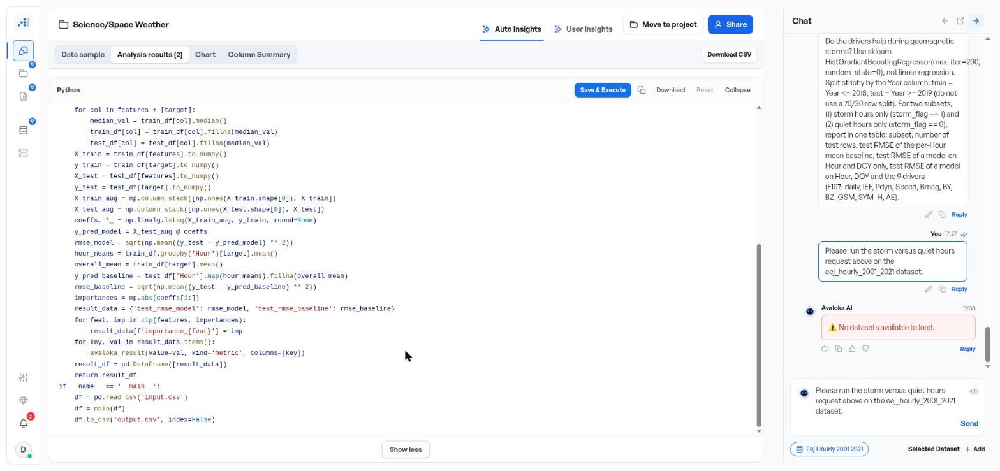
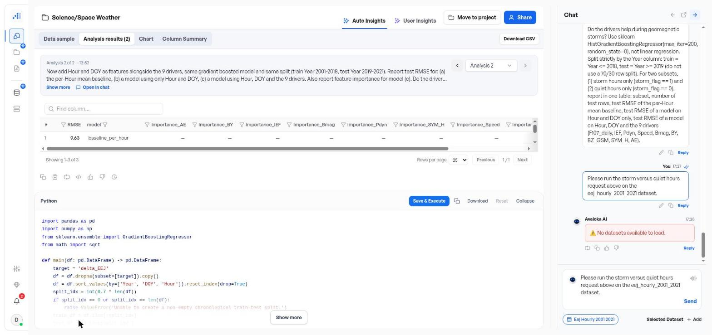

# Can solar and geomagnetic drivers predict the equatorial electrojet?

Avaloka Engineering Intern Hackathon, 14–15 November 2026. Analysis run in [Avaloka](https://avaloka.ai).

## Question

Can solar and geomagnetic drivers predict hourly `delta_EEJ` (equatorial electrojet strength) better than a time-of-day baseline, and which drivers matter?

## Answer

No. In both runs Avaloka completed, the drivers did not beat a baseline that only knows the hour of day.

Reading the code Avaloka generated also showed that neither run did exactly what was asked, and that the chat summaries did not say so. Both are reproduced below and reported as issues on the Avaloka repo.

## Dataset

`eej_hourly_2001_2021.csv` — 145,188 rows, 16 columns, 9.0 MB, no missing values.

- Hourly means of one-minute data for 2001–2021 (no data for 2012). Hours with fewer than 30 minutes of data are dropped.
- Time is UT.

| Column | Meaning |
|---|---|
| `Year`, `Month`, `Day`, `DOY`, `Hour` | Date and hour (UT); `DOY` is day of year |
| `F107_daily` | Daily F10.7 solar radio flux |
| `IEF` | Interplanetary electric field |
| `Pdyn` | Solar wind dynamic pressure |
| `Speed` | Solar wind speed |
| `Bmag`, `BY`, `BZ_GSM` | Interplanetary magnetic field magnitude and components |
| `SYM_H` | SYM-H geomagnetic index |
| `AE` | Auroral electrojet index |
| `storm_flag` | 1 if the hour falls in a geomagnetic storm interval |
| `delta_EEJ` | Target: equatorial electrojet strength |

## What was asked

Both questions asked for gradient-boosted trees, trained on 2001–2018 and tested on 2019–2021.

1. Can the nine drivers predict `delta_EEJ` better than the mean `delta_EEJ` for each hour?
2. Do the drivers add anything once hour and day of year are already features?

## What Avaloka ran, and what it reported

Test RMSE, lower is better.

### Run 1: drivers only

| Model | Test RMSE |
|---|---|
| Per-hour mean baseline | 8.92 |
| "Gradient-boosted tree model", 9 drivers | 10.44 |

- **Split:** by year, as asked (22,525 test hours).
- **Model:** the generated code fits ordinary least squares with `np.linalg.lstsq`. No tree model is imported or trained. The chat summary still calls it "the gradient-boosted tree model".
- **Importance:** the reported "feature importance" is the absolute value of the raw regression coefficients, so it depends on each column's units. `BZ_GSM` (0.248), `Pdyn` (0.115) and `BY` (0.050) rank highest only because they are measured in small numbers. Scaled by each column's standard deviation, the order becomes `IEF`, `SYM_H`, `BZ_GSM`, and `IEF` was reported as contributing "very little".

### Run 2: time features, with and without drivers

| Model | Test RMSE |
|---|---|
| Per-hour mean baseline | 9.63 |
| Hour + day of year | 9.44 |
| Hour + day of year + 9 drivers | 9.79 |

- **Model:** `GradientBoostingRegressor` with 200 trees, as asked.
- **Split:** the generated code sorts the rows and cuts at 70% (`split_idx = int(0.7 * len(df))`). Training ends on 16 May 2016 and the test set is 43,557 hours, not the 2019–2021 hold-out that was requested. The chat summary does not mention the change.
- This is why the same per-hour baseline reads 8.92 in run 1 and 9.63 in run 2.

## Independent checks

Recomputed with pandas and numpy on the full file:

| Quantity | Avaloka | Recomputed |
|---|---|---|
| Per-hour baseline, year split (run 1) | 8.92 | 8.92 |
| Linear regression on 9 drivers, year split (run 1) | 10.44 | 10.44 |
| Raw coefficients for `BZ_GSM`, `Pdyn`, `BY` (run 1) | 0.248, 0.115, 0.050 | 0.248, 0.115, 0.050 |
| Per-hour baseline, 70/30 row split (run 2) | 9.63 | 9.63 |
| Constant prediction (overall training mean), year split | not reported | 10.46 |

The two tree-model figures in run 2 (9.44 and 9.79) are Avaloka's and were not independently reproduced.

## What this means

- A linear model on the nine drivers (10.44) is no better than predicting one constant (10.46), and clearly worse than the per-hour mean (8.92).
- On the 70/30 split, adding the drivers to hour and day of year raised the error from 9.44 to 9.79.
- Hour of day and season carry almost all the predictable signal at hourly resolution.
- Still open: gradient-boosted trees on the requested 2019–2021 hold-out were never actually run, so the answer rests on a linear model for that split and a tree model for a different split.

## What broke or was confusing

1. **Summary does not match code (run 1).** Asked for gradient-boosted trees; the code ran linear regression; the summary said gradient-boosted trees.
2. **Requested split silently replaced (run 2).** Asked for a 2019–2021 hold-out; the code used a 70/30 row split; the summary did not say so.
3. **Timeout.** The first training plan was a 30-epoch neural network with batch size 32. It failed with "Script execution timed out after 60 seconds".
4. **Dataset became unavailable.** About four hours after upload, the same chat answered every new question with "No datasets available to load", although the dataset was still listed as attached. Re-uploading the file to a new analysis failed twice with "Failed to persist session. Please retry." A planned third question (storm hours versus quiet hours) could not be run.
5. **Auto Insights** focused on `storm_flag` and the date columns and did not pick out `delta_EEJ` as the quantity of interest.
